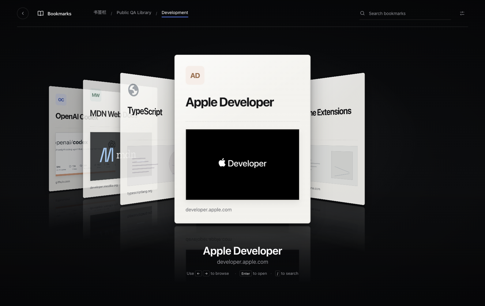

<div align="center">
  

# Bookmark Cover Flow

**Your Chrome bookmarks, arranged like an editorial Cover Flow.**

[](https://github.com/kekincai/bookmark-cover-flow/actions/workflows/ci.yml)
[](https://github.com/kekincai/bookmark-cover-flow/releases/latest)
[](public/manifest.json)
[](LICENSE)

[Install](#install) · [Features](#features) · [Architecture](docs/architecture.md) · [Privacy](docs/privacy-policy.md) · [Contributing](docs/contributing.md)

</div>



Bookmark Cover Flow is a quiet, spatial way to browse Chrome bookmarks. Click the extension button and it opens in a normal tab—never over your New Tab page. Real bookmark folders remain intact, while webpage previews turn each bookmark into a tactile editorial cover.

<div align="center">
  <a href="docs/assets/demo.gif"><strong>Watch the interaction demo →</strong></a>
</div>

## Why it feels different

| Editorial covers                                                                                          | Spatial motion                                                                                | Your folders, unchanged                                                                                 |
| --------------------------------------------------------------------------------------------------------- | --------------------------------------------------------------------------------------------- | ------------------------------------------------------------------------------------------------------- |
| Open Graph images, favicons, and deterministic fallbacks make bookmarks recognizable before opening them. | Trackpad, wheel, pointer drag, keyboard, inertia, and snap share one continuous motion model. | Nested Chrome folders become a stable breadcrumb rail with no uploads, account, or proprietary library. |

## Features

- opens from the toolbar as a regular bookmarkable or pinnable extension tab
- navigates the real Chrome bookmark hierarchy with stable breadcrumbs and back navigation
- previews webpage imagery inside large, paper-like editorial covers
- supports trackpad, wheel, pointer drag, click, and keyboard navigation
- searches titles, hostnames, and URLs instantly without leaving Cover Flow
- includes a local Recent collection and four sorting modes
- offers dark, light, and system themes plus optional floor reflection
- virtualizes the scene to `selectedIndex ± 7` for large libraries
- respects reduced motion, forced colors, focus navigation, and screen-reader metadata
- stays local-first with no analytics, account, backend, or bookmark uploads

## Install

### From a release

1. Download `bookmark-cover-flow.zip` from the [latest release](https://github.com/kekincai/bookmark-cover-flow/releases/latest).
2. Unzip it.
3. Open `chrome://extensions`.
4. Enable **Developer mode**.
5. Choose **Load unpacked** and select the unzipped folder.
6. Pin **Bookmark Cover Flow**, then click its toolbar icon.

### From source

Requirements: Node.js 22+ and Chrome 120+.

```bash
git clone https://github.com/kekincai/bookmark-cover-flow.git
cd bookmark-cover-flow
npm ci
npm run build
```

Load the generated `dist` folder from `chrome://extensions`. Running `npm run dev` opens a public demo library and never reads personal bookmarks.

## Keyboard

| Key                   | Action                   |
| --------------------- | ------------------------ |
| `←` / `→`             | Previous / next bookmark |
| `Enter`               | Open the active bookmark |
| `/` or `⌘K`           | Focus search             |
| `Esc`                 | Clear and leave search   |
| `Home` / `End`        | First / last bookmark    |
| `PageUp` / `PageDown` | Move five bookmarks      |

## Architecture

```text
Domain → Application → Infrastructure → UI
```

Native TypeScript and browser APIs keep the extension small. Pure functions own search, sorting, cover transforms, selection, and motion physics; Chrome APIs, storage, events, animation frames, and DOM rendering stay at the edge.

Read the [architecture](docs/architecture.md), [stable APIs](docs/api.md), [motion design](docs/motion-design.md), and [performance validation](docs/performance.md).

## Verified quality

```bash
npm run typecheck
npm run lint
npm run test
npm run test:e2e
npm run test:extension
```

The isolated extension test seeds 15 public bookmarks plus a 5,000-item stress folder, verifies real preview retrieval, opens a bookmark, checks Recent, exercises view settings, and confirms DOM virtualization without reading the user's Chrome profile.

## Permissions and privacy

| Permission                  | Why it is needed                                                         |
| --------------------------- | ------------------------------------------------------------------------ |
| `bookmarks`                 | Read the bookmark tree displayed in Cover Flow                           |
| `storage`                   | Remember local view preferences and preview metadata                     |
| `favicon`                   | Resolve icons through Chrome's local favicon service                     |
| `http://*/*`, `https://*/*` | Fetch public page metadata without credentials for nearby cover previews |

Requests omit credentials, time out after eight seconds, and are limited to nearby covers. See the full [privacy policy](docs/privacy-policy.md).

## Roadmap

- **v0.1–v0.5 ✓** — architecture, bookmarks, motion, folders, search, sorting, performance, accessibility
- **v1.0 ✓** — stable APIs, packaging, documentation, and store-ready release
- **v1.1 ✓** — editorial cover system, fixed breadcrumb header, spatial graphite stage, redesigned view options

## Contributing

Issues and pull requests are welcome. See [Contributing](docs/contributing.md) and [Security](SECURITY.md).

## License

[MIT](LICENSE)
