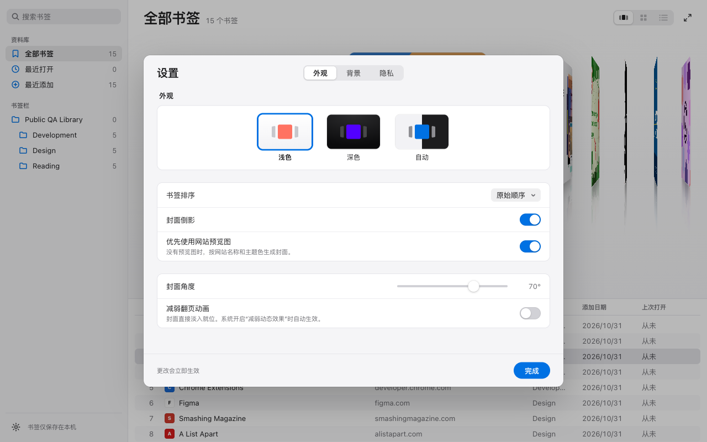

<div align="center">
  

# Bookmark Cover Flow

**Your Chrome bookmarks, flipping like album covers.**

[](https://github.com/kekincai/bookmark-cover-flow/actions/workflows/ci.yml)
[](https://github.com/kekincai/bookmark-cover-flow/releases/latest)
[](public/manifest.json)
[](LICENSE)

[Install](#install) · [Features](#features) · [Architecture](docs/architecture.md) · [Privacy](docs/privacy-policy.md) · [Contributing](docs/contributing.md)

</div>


Bookmark Cover Flow is a quiet, spatial way to browse Chrome bookmarks. Click the extension button and it opens in a normal tab—never over your New Tab page. Real bookmark folders remain intact. The interface is flat and neutral, in the spirit of Apple Music and System Settings on macOS, so every color on screen comes from your covers.

<div align="center">
  <a href="docs/motion-design.md"><strong>Explore the motion and optical design →</strong></a>
</div>

## Why it feels different

| Album-style covers                                                                                               | Classic Cover Flow motion                                                                             | Your folders, unchanged                                                                       |
| ---------------------------------------------------------------------------------------------------------------- | ----------------------------------------------------------------------------------------------------- | --------------------------------------------------------------------------------------------- |
| Site preview images, or a generated cover in one of four templates colored by the site's theme color or favicon. | 3D page turns with mirror reflections; trackpad, wheel, drag, keyboard and scrubber share one spring. | A sidebar of your real Chrome folders plus All Bookmarks, Recently Opened and Recently Added. |

## Features

- opens from the toolbar as a regular bookmarkable or pinnable extension tab
- sidebar with search, a Library (All Bookmarks, Recently Opened, Recently Added) and your real Chrome folders with counts
- Cover Flow stage with adjustable cover angle (45–80°), optional mirror reflection, a hover “Open ↗” pill and a slim scrubber
- album-style generated covers when a site has no preview: one of four templates (`mono`, `type`, `circle`, `bands`) chosen per domain, colored from the site's `theme-color` or favicon
- a list under the stage with name, website, folder, date added and last opened; selecting a row moves the covers, and search matches are highlighted
- full-screen Cover Flow (`F`) on a dark stage tinted by the current cover
- searches titles, hostnames, URLs and folder names instantly
- four sorting modes, light, dark and automatic themes, and a choice of stage backgrounds: default, Mist, Night, or your own photo or video
- “Prefer website preview images” can be turned off so no website is ever contacted
- virtualizes covers to `selectedIndex ± 7` and list rows to the visible window, so 5,000-bookmark folders stay at 60 fps
- respects Reduce Motion (or the in-app “Reduce flip animation”), forced colors, keyboard focus zones and screen-reader metadata
- stays local-first with no analytics, account, backend, or bookmark uploads

Not built yet: the Grid and List buttons in the view switcher are shown disabled; the list under the stage is always available.

## Install

### From a release

1. Download `bookmark-cover-flow.zip` from the [latest release](https://github.com/kekincai/bookmark-cover-flow/releases/latest).
2. Unzip it.
3. Open `chrome://extensions`.
4. Enable **Developer mode**.
5. Choose **Load unpacked** and select the unzipped folder.
6. Pin **Bookmark Cover Flow**, then click its toolbar icon.

### From source

Requirements: Node.js 22+ and Chrome 120+.

```bash
git clone https://github.com/kekincai/bookmark-cover-flow.git
cd bookmark-cover-flow
npm ci
npm run build
```

Load the generated `dist` folder from `chrome://extensions`. Running `npm run dev` opens a public demo library and never reads personal bookmarks.

## Keyboard

| Key                   | Action                              |
| --------------------- | ----------------------------------- |
| `←` / `→`             | Previous / next bookmark            |
| `Enter`               | Open the active bookmark            |
| `⌘Enter`              | Open in a background tab            |
| `/` or `⌘K`           | Focus search                        |
| `Esc`                 | Clear search; exit full screen      |
| `Home` / `End`        | First / last bookmark               |
| `PageUp` / `PageDown` | Move five bookmarks                 |
| `F`                   | Enter / exit full-screen Cover Flow |

Arrow keys act on the focused area: the stage, the list (`↑` / `↓`) and the sidebar each navigate independently. Shortcuts never fire while you type in a field.

## Architecture

```text
Domain → Application → Infrastructure → UI
```

Native TypeScript and browser APIs keep the extension small. Pure functions own search, sorting, cover transforms, selection, and motion physics; Chrome APIs, storage, events, animation frames, and DOM rendering stay at the edge.

Read the [architecture](docs/architecture.md), [stable APIs](docs/api.md), [motion design](docs/motion-design.md), and [performance validation](docs/performance.md).

Previews are site-provided images, not full-page screenshots.

## Backgrounds and settings

Open settings with the gear at the bottom of the sidebar. The panel has three tabs: **Appearance** (theme, sorting, reflection, preview images, cover angle, reduced flip animation), **Background** (the stage background: Default, Mist, Night, or a photo or video), and **Privacy** (what stays local, plus buttons to clear the preview cache and the Recently Opened history). Changes apply immediately.

The interface automatically follows Chrome's UI language. Simplified Chinese, Traditional Chinese, Japanese and English are included; other languages fall back to English. In the development preview, the browser language is used instead. Settings, accessible labels, playback status, error messages and extension metadata share the same `_locales` catalogs. Bookmark titles and file names are never translated. Reopen the extension after changing Chrome's UI language.



Screenshots use an isolated Chrome profile with public bookmarks, never a personal bookmark library.

- Backgrounds apply to the Cover Flow stage only. Local photos and videos up to 512 MB are saved as original Blobs in IndexedDB, never uploaded or synchronized. Reopening the extension restores the selected file.
- Videos loop silently using the native video element. They pause while the tab is hidden; a manual pause is remembered. Reduced-motion users start new videos paused.
- HDR video bytes and color metadata are retained without transcoding or canvas processing. Actual HDR output requires a compatible file/codec, Chrome/system decoder, and HDR-enabled display. Unsupported files show an error without replacing the previous background.
- Photos support blur; both photos and videos support dimming. Video blur is intentionally unavailable to keep playback free of CSS filters. Use zero dimming for the unmodified video appearance.
- Choosing Mist or Night replaces a stored photo or video. **Restore default background** removes only the stored wallpaper copy; original files, bookmarks and appearance preferences are untouched. Clearing extension data or uninstalling also removes the stored copy.

The media regression suite accepts `WALLPAPER_TEST_VIDEO=/absolute/path/to/video.webm npm run test:e2e`. This additional test checks real decoding, mute state, pause persistence and stable playback across settings tabs; it is skipped when no video fixture is supplied.

## Verified quality

```bash
npm run typecheck
npm run lint
npm run test
npm run test:e2e
npm run test:extension
```

The isolated extension test seeds 15 public bookmarks plus a 5,000-item stress folder, verifies real preview retrieval, opens a bookmark, checks Recent, exercises view settings, and confirms DOM virtualization without reading the user's Chrome profile.

## Permissions and privacy

| Permission                  | Why it is needed                                                         |
| --------------------------- | ------------------------------------------------------------------------ |
| `bookmarks`                 | Read the bookmark tree displayed in Cover Flow                           |
| `storage`                   | Remember local view preferences and preview metadata                     |
| `favicon`                   | Resolve icons through Chrome's local favicon service                     |
| `http://*/*`, `https://*/*` | Fetch public page metadata without credentials for nearby cover previews |

Requests omit credentials, time out after eight seconds, and are limited to nearby covers. See the full [privacy policy](docs/privacy-policy.md).

## Roadmap

- **v0.1–v0.5 ✓** — architecture, bookmarks, motion, folders, search, sorting, performance, accessibility
- **v1.0 ✓** — stable APIs, packaging, documentation, and store-ready release
- **v1.1 ✓** — editorial cover system, fixed breadcrumb header, spatial graphite stage, redesigned view options
- **Unreleased · main** — modern Apple-style redesign: sidebar library, generated album covers, list view, full-screen Cover Flow, stage backgrounds, settings with Appearance/Background/Privacy tabs; Liquid Glass removed. Available from source, not yet tagged as a release
- **Later** — Grid and List views

## Contributing

Issues and pull requests are welcome. See [Contributing](docs/contributing.md) and [Security](SECURITY.md).

## License

[MIT](LICENSE)
