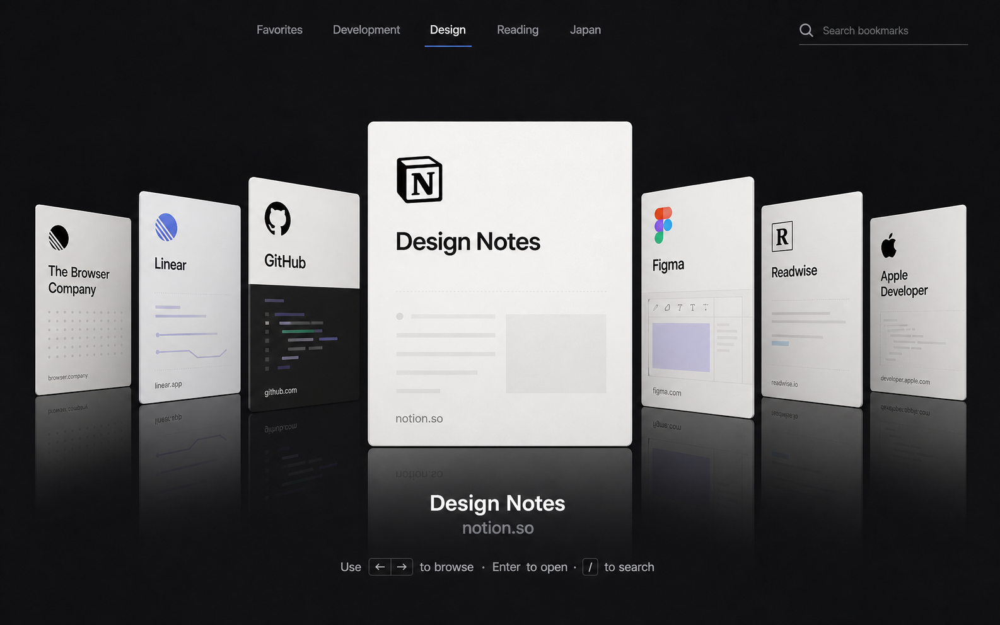

# Bookmark Cover Flow



A quiet, spatial Chrome bookmark browser inspired by the browsing rhythm of classic Cover Flow and redesigned for today's new-tab experience.

The active bookmark stays clear and centered while neighboring covers recede into a continuous 3D scene. Trackpad, mouse, keyboard, search, and folder navigation all feed the same motion model.

## Features

- Chrome New Tab Override with a directly accessible extension page
- real Chrome bookmark folders through the Bookmarks API
- continuous fractional-position motion with inertia, velocity damping, and snap
- trackpad, wheel, pointer drag, click, and keyboard navigation
- instant title, hostname, and URL search without leaving Cover Flow
- favicon covers with restrained generated fallbacks
- DOM virtualization (`selectedIndex ± 7`) for large libraries
- system dark/light mode and `prefers-reduced-motion`
- local-first operation with no account, backend, analytics, or bookmark uploads

## Design philosophy

Quiet, refined, editorial, spatial, premium, and minimal. The cover is the interface: navigation and metadata stay deliberately low-key, gradients and reflections are restrained, and the scene avoids card-grid dashboard chrome.

## Architecture

The project uses native TypeScript and Web APIs with a lightweight Clean Architecture:

```text
Domain → Application → Infrastructure → UI
```

Pure functions own search, transform calculation, bookmark mapping, selection, and motion physics. Chrome APIs, storage, events, animation frames, and DOM rendering remain at the edge. See [Architecture](docs/architecture.md) and [Motion design](docs/motion-design.md).

## Getting started

Requirements: Node.js 22 or newer and Chrome 120 or newer.

```bash
npm install
npm run dev
```

Outside an extension context, development mode provides a small demo library so the full interface and tests work without exposing personal bookmarks.

## Development

```bash
npm run typecheck
npm run lint
npm run test
npm run test:e2e
```

## Build

```bash
npm run build
```

The unpacked extension is written to `dist/`.

## Install the extension

1. Run `npm run build`.
2. Open `chrome://extensions`.
3. Enable **Developer mode**.
4. Choose **Load unpacked** and select the generated `dist` folder.
5. Open a new tab.

## Keyboard

| Key | Action |
| --- | --- |
| `←` / `→` | Previous / next bookmark |
| `Enter` | Open the active bookmark |
| `/` or `⌘K` | Focus search |
| `Esc` | Clear and leave search |
| `Home` / `End` | First / last bookmark |

## Permissions and privacy

- `bookmarks`: read the bookmark tree shown in Cover Flow.
- `storage`: remember local interface preferences.
- `favicon`: ask Chrome's local favicon service for bookmark icons.

Your bookmarks never leave your browser. The extension contains no third-party analytics, network API, user account, or backend.

## Roadmap

- **v0.1** — architecture, Chrome bookmarks, static Cover Flow, keyboard
- **v0.2** — continuous motion, trackpad/wheel, inertia, snap
- **v0.3** — favicon covers, reflection, folder navigation, themes
- **v0.4** — search, recent items, custom sorting
- **v0.5** — further performance and accessibility tuning
- **v1.0** — polished motion, stable APIs, store-ready release

## Contributing

See [Contributing](docs/contributing.md). Pull requests should explain What, Why, How, Test, and include visual evidence where relevant.

## License

[MIT](LICENSE)
